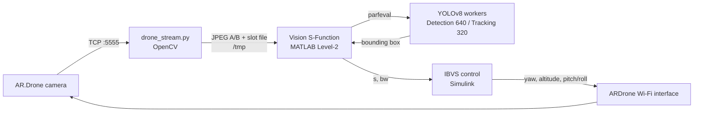

# Autonomous UAV with AI-based Visual Servoing

**Autonomous drone-to-drone tracking with a Parrot AR.Drone, using YOLOv8 detection and image-based visual servoing (IBVS) in MATLAB/Simulink.**


A Parrot AR.Drone detects, confirms and follows another drone (the *target*) using only its front camera. A single-class (`UAV`) YOLOv8 network provides the target's position in the image, and a Simulink visual-servoing control law generates the flight commands in real time over Wi-Fi.

---

## Demo

### Full tracking performance


> Full video (1080p, ~27 s): [`Complete performance.mov`](<Videos demosnstration/Complete performance.mov>)

### Yaw and altitude control


> Full video (1080p, ~35 s): [`Yaw & Altitude.mov`](<Videos demosnstration/Yaw & Altitude.mov>)

---

## Features

- **Two-stage YOLOv8 detection**: a 640×640 model searches for the target in the full frame, and a lighter 320×320 model tracks it on a crop centered on the last detection, reducing inference cost.
- **Asynchronous inference** using `parfeval` on a parallel pool, so the Simulink control loop (Ts = 0.03 s) never blocks waiting for the network.
- **Target confirmation** before tracking starts, and **false-positive rejection** (implausible position or size jumps).
- **Image-based visual servoing (IBVS)**: the normalized image error `s` and the bounding-box width `bw` feed the yaw, altitude and forward controllers.
- **No Kalman filter**: the control signal comes only from real detections, holding the last valid value (*zero-order hold*) between detections.
- **Decoupled video streaming**: a Python script captures the drone's video and hands frames to MATLAB through a double buffer with atomic writes.

---

## Architecture



### Vision pipeline

1. **Acquisition**: `drone_stream.py` reads the video stream at `tcp://192.168.1.1:5555`, writes frames alternating between `/tmp/droneA.jpg` and `/tmp/droneB.jpg`, and records in `/tmp/drone_slot.txt` which one is the latest complete frame.
2. **Detection**: with no target, the 640×640 model runs on the full frame.
3. **Confirmation**: the target must be detected in at least 2 consecutive inferences, with a minimum confidence of 0.3 and without moving more than 50% of the crop size.
4. **Tracking**: once confirmed, a 320×320 window centered on the last detection is cropped and passed to the lightweight model. Jumps larger than 40% of the crop, or size changes outside the 0.4–2.5× range, are rejected.
5. **Target loss**: if there is no detection, or no new frame arrives for ~10 cycles (~0.3 s), the tracker falls back to detection and the outputs are reset to zero.
6. **Output**: from the bounding-box center `(u, v)` and width `bw`, the normalized image error is computed using the camera intrinsics:

   ```
   s = [ (u − Cu) / (fu·α) ,  (v − Cv) / fv ],   α = fv / fu
   ```

---

## Repository structure

```
.
├── start_here.m                    # Entry point
├── Videos demosnstration/          # Demo videos
│   ├── Complete performance.mov
│   └── Yaw & Altitude.mov
├── assets/                         # GIF previews used in this README
└── wifiControl/
    ├── ARDroneControl.slx          # Simulink drone control model
    ├── ONXX Models/                # Trained YOLOv8 models (.pt and .onnx)
    │   ├── best_640_downsampled_2.onnx / .pt   # Detection
    │   └── best_320_downsampled_2.onnx / .pt   # Tracking
    ├── Classes/                    # YOLOv8 wrapper and helper layers
    ├── +utils/                     # YOLOv8 preprocessing, anchors, DFL and postprocessing
    └── Functions/
        ├── setupHover.m                       # Initializes and opens the Simulink model
        ├── DroneStream_tracking_init.m        # InitFcn: launches Python, loads models, creates the pool
        ├── computer_vision_sfun_no_kalman.m   # Vision S-Function (version in use, no Kalman)
        ├── yoloTrackingWorker.m               # Worker that runs inference
        ├── detectYOLOv8.m / importYOLOv8Model.m
        └── drone_stream.py                    # Drone video capture
```

---

## Requirements

**Hardware**
- Parrot AR.Drone (with its front camera) as the chasing drone.
- A second drone as the target.
- A computer with Wi-Fi to connect to the drone's network.

**Software**
- MATLAB with Simulink.
- Parallel Computing Toolbox (`parpool`, `parfeval`).
- Deep Learning Toolbox (ONNX model import and `dlnetwork`) and computer vision toolboxes.
- Python 3 with [`opencv-python`](https://pypi.org/project/opencv-python/).
- [ARDrone Simulink Development Kit](https://www.mathworks.com/matlabcentral/fileexchange/) (the `lib/` folder with the drone communication blocks). *Not included in this repository.*

---

## Installation and usage

1. **Clone the repository**

   ```bash
   git clone https://github.com/davribsan/Autonomous-UAV-with-AI-based-visual-servoing.git
   cd Autonomous-UAV-with-AI-based-visual-servoing
   ```

2. **Set up the Python environment**

   ```bash
   conda create -n drone_env python=3.10
   conda activate drone_env
   pip install opencv-python
   ```

3. **Configure the paths** (see [Configuration](#configuration)).

4. **Connect your computer to the drone's Wi-Fi network.**

5. **Run the system** from MATLAB, at the project root:

   ```matlab
   start_here
   ```

   This clears the workspace, runs `setupHover` and opens `ARDroneControl.slx`. When the simulation starts, the model's `InitFcn`:
   - launches `drone_stream.py` in the background,
   - creates a pool of 2 workers,
   - loads the detection and tracking models,
   - waits for the first frame.

6. **Take off and fly** using the model's controls (*take off*, *fly*, *land*, *emergency stop* and *Kill-Switch*).

---

## Configuration

The following values are hard-coded and **must be adapted to your machine**:

| File | Parameter | Description |
|---|---|---|
| `wifiControl/Functions/DroneStream_tracking_init.m` | `modelPathDetection`, `modelPathTracking` | Absolute paths to the `.onnx` models |
| `wifiControl/Functions/DroneStream_tracking_init.m` | `pyExe`, `pyScript` | Python interpreter and path to `drone_stream.py` |
| `wifiControl/Functions/DroneStream_tracking_init.m` | `workerPath` | Path to `Functions/` for the parallel workers |
| `wifiControl/ARDroneControl.slx` | Model `InitFcn` | Path to `DroneStream_tracking_init.m` |
| `wifiControl/Functions/drone_stream.py` | `cv2.VideoCapture(...)` | Stream address (default `tcp://192.168.1.1:5555`) |

### Tracker parameters

Defined in `computer_vision_sfun_no_kalman.m`:

| Parameter | Value | Meaning |
|---|---|---|
| `imageSizeTracking` | 320 px | Tracking crop size |
| `minConfirmCount` | 2 | Detections required to confirm the target |
| `minConfirmScore` | 0.3 | Minimum confidence during confirmation |
| `maxConfirmDrift` | 0.5 × 320 px | Maximum displacement between confirmation detections |
| `maxTrackJump` | 0.4 × 320 px | Maximum accepted jump between consecutive detections |
| `maxMisses` | 1 | Consecutive misses before falling back to detection |
| `maxStaleWhileTracking` | 10 cycles | Cycles without a new frame before the tracker is reset |

### Camera calibration

The camera intrinsics are defined per drone in the S-Function (`Dron = 1` or `3`). If you use a different drone, calibrate your camera and update `fu`, `fv`, `Cu` and `Cv`.

---

## YOLOv8 models

| Model | Input | Use |
|---|---|---|
| `best_640_downsampled_2` | 640×640 | Detection on the full frame |
| `best_320_downsampled_2` | 320×320 | Tracking on a local crop |

Both are **single-class (`UAV`)** detectors, provided in PyTorch (`.pt`) and ONNX (`.onnx`) formats. MATLAB loads the `.onnx` files.

---

## Safety

> **⚠️ This system controls a real aerial vehicle.**
> - Always fly in a controlled space, with a protective net if possible.
> - Keep the *Kill-Switch* and *emergency stop* within reach throughout the flight.
> - The base model's position estimate integrates the velocity reported by the drone and is inaccurate; it may lead to unexpected behavior.

---

## Known limitations

- Machine-dependent absolute paths (see [Configuration](#configuration)).
- Frames are exchanged through `/tmp`, so the workflow is designed for macOS/Linux.
- Single target: the highest-scoring detection is followed.
- No prediction between detections (the last valid value is held).

---

## Credits

- Simulink control and AR.Drone communication model based on the **ARDrone Simulink Development Kit** by David Escobar Sanabria and Pieter J. Mosterman.
- Detector based on [Ultralytics YOLOv8](https://github.com/ultralytics/ultralytics).

## Author

**David Ribeiro Sanjorge** — [@davribsan](https://github.com/davribsan)
